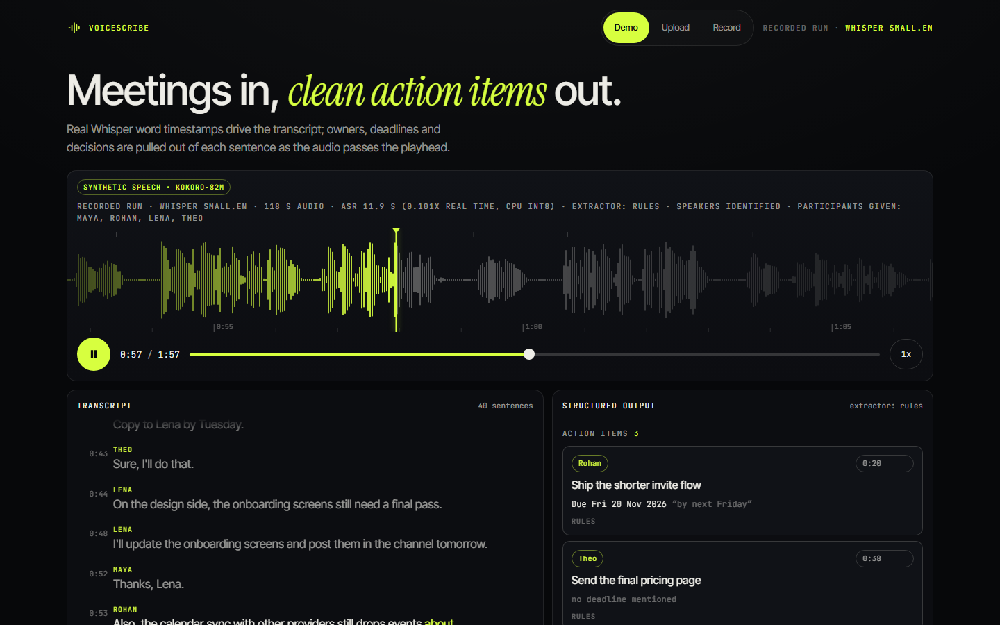
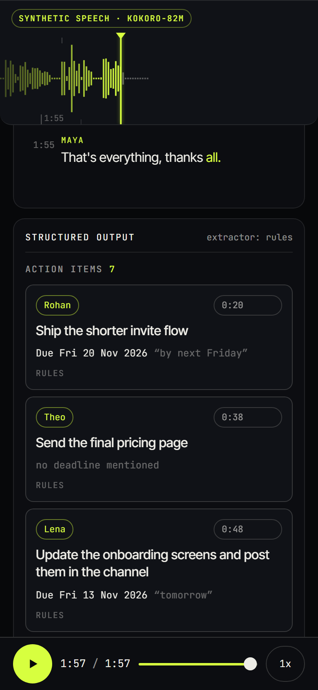
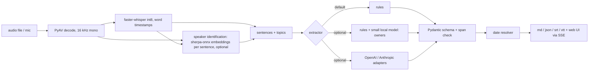

# VoiceScribe

[](https://github.com/Aditya2616/VoiceScribe/actions/workflows/ci.yml)
[](LICENSE)

**Meetings in, clean action items out.** VoiceScribe turns a meeting recording into a transcript with word-level
timestamps, splits it into sentences and topics, and pulls out decisions, owners and deadlines as structured,
validated action items. It runs offline on a CPU. Python, Whisper (faster-whisper), optional LLM adapters (untested against live APIs, see Results).

I built it to see how far a small, checkable pipeline gets before reaching for a big model, and to measure that
honestly instead of assuming it.





The web UI plays a recording. The waveform scrolls past a fixed playhead locked to `audio.currentTime`, each word
appears at its real Whisper timestamp, and every action item animates into the panel when the sentence it came from
ends. Tapping an item seeks the audio to its source.

> The demo meeting is **synthetic speech** (voiced with Kokoro-82M, Apache-2.0, from a script I wrote with invented
> names and a made-up company). It is not a real meeting. The static page replays the saved output of a real run of this
> code on that audio, and says so in the UI. That run used Whisper <!--n:demo_model-->small.en<!--/n--> and the attendee list
> (<!--n:demo_participants-->Maya, Rohan, Lena, Theo<!--/n-->) from the script; the quickstart below uses the smaller default,
> Whisper <!--n:default_whisper-->base.en<!--/n-->.

## How it works



- **Decode and ASR.** PyAV decodes (so no ffmpeg), faster-whisper runs int8 with word timestamps. PyAV is
  pinned to <!--n:av_pin-->>=15,<17<!--/n--> because newer releases break faster-whisper 1.2.
- **Segmentation.** Sentences from punctuation with a pause fallback; topics with a TextTiling-style cohesion score,
  labelled with their most distinctive phrase.
- **Extraction.** An extractor ladder behind one interface (`VOICESCRIBE_EXTRACTOR`): `rules` (default);
  `local`, rules plus a small model that picks an owner from a closed list of names for unassigned items;
  `local-verify`, rules plus a model that relabels candidates; and OpenAI/Anthropic adapters. Measured, only
  the rules are good enough to be the default (see Results).
- **Validation.** Every item carries a source span that is checked against the transcript; items whose quote is not
  in the transcript are rejected. Deadlines such as "by next Friday" or "end of the month" are resolved to real
  dates relative to the meeting date.
- **Summary.** The offline summary is **extractive** (TF-IDF centrality, labelled "extractive" in the UI). Abstractive
  summaries only come from the hosted adapters.

## Results

Every number below is generated from `results/`, `docs/demo/meeting.json` and the code by `scripts/check_numbers.py`,
and a fast test fails if this README drifts from them. Speech recognition runs on the CPU (int8); the device of each
extraction row is in its last column. The sets are small, so treat differences of a few points as noise.

### Speech recognition (CPU, int8)

<!--b:speech_table-->
| Set | Model | Words | WER |
|---|---|---|---|
| LibriSpeech test-clean subset (12 utterances, read speech) | small.en | 278 | 3.96% |
| same | base.en | 278 | 6.12% |
| Synthetic demo meeting, recogniser output as is (scored against its script) | small.en | 336 | 1.49% (5 substitutions) |
| Synthetic demo meeting, recorded run (names corrected from the attendee list) | small.en | 336 | 0.30% (1 substitution) |
<!--/b:speech_table-->

Commands: `voicescribe eval wer --model small.en` (LibriSpeech, the first two rows) and
`voicescribe eval demo --model small.en` (the demo meeting). Both are read or synthetic speech, not real far-field
meetings, so they say little about real meeting audio. The recorded run's names come from the supplied attendee list,
which is why its WER is lower than the recogniser's own.

**Speed.** Transcription speed on the CPU (int8, <!--n:threads-->3<!--/n--> threads) for the demo meeting
(<!--n:speed_audio-->117.7 s<!--/n--> of synthetic speech), measured on <!--n:speed_date-->2026-11-13<!--/n--> by `python scripts/rerecord_demo.py`. Model loading
is not included. A figure counts as clean only when the CPU was under <!--n:quiet_pct-->25%<!--/n--> busy just before the run; every row below is
clean (at most <!--n:speed_busy_max-->5.7%<!--/n--> busy). The real-time factor is transcription seconds per audio second, so below 1 is faster
than real time.

<!--b:speed_table-->
| Model | Audio | Transcription time | Real-time factor | CPU busy before | WER vs script |
|---|---|---|---|---|---|
| tiny.en | 117.7 s | 2.3 s | 0.020 (50x faster than real time) | 5.7% | 1.79% |
| base.en | 117.7 s | 4.1 s | 0.035 (29x faster than real time) | 3.1% | 0.60% |
| small.en | 117.7 s | 12.0 s | 0.102 (10x faster than real time) | 3.6% | 1.19% |
<!--/b:speed_table-->

One run per model on one machine, so these are indicative, not averages. The WER column scores each speed run's own transcript
against the demo script; those runs were made without the attendee list, so they are not the recorded run scored in the
table above. The demo banner shows the recorded run's own timing
(small.en, <!--n:demo_asr_s-->11.9 s<!--/n-->, real-time factor <!--n:demo_rtf-->0.101<!--/n-->, CPU <!--n:demo_busy-->2.2%<!--/n--> busy before the run). That is a separate
run from the small.en row above, so the two differ slightly.

**Word-timestamp accuracy** on the demo meeting, using the recogniser's own words (sentence first and last word against
the TTS segment timings, <!--n:ts_n-->69<!--/n--> boundaries): median absolute error <!--n:ts_median-->100 ms<!--/n-->,
90th percentile <!--n:ts_p90-->255 ms<!--/n-->, <!--n:ts_within-->87%<!--/n--> within 250 ms. Sentence ends run about
<!--n:ts_end-->170 ms early<!--/n--> on average, starts about <!--n:ts_start-->51 ms early<!--/n-->. In the browser the revealed word
count equals the number of words whose start time is at or before `audio.currentTime` (checked by
`scripts/screenshots.py`).

### Action-item extraction

Matching: a predicted item counts when it shares a sentence with a gold item of the same kind. All
<!--n:n_all-->17<!--/n--> meetings are hand-labelled, written by me, with invented names and companies, about
<!--n:mean_sent-->15<!--/n--> sentences each. `dev` (<!--n:n_dev-->4<!--/n--> meetings) is where the rules were developed.
**The held-out set is <!--n:n_heldout-->9<!--/n--> meetings** (<!--n:n_held-->6<!--/n--> `held` meetings written after the rules were frozen, plus <!--n:n_test2-->3<!--/n--> `test2` meetings that I had already seen). The `held` meetings have <!--n:sent_held-->85<!--/n--> sentences, <!--n:act_held-->23<!--/n--> action items and <!--n:dec_held-->6<!--/n--> decisions, in varied styles (terse stand-ups, chatty marketing calls, trailing and leading names, items with no owner), and I did not tune on them. One bug was fixed after the `held` run: the
"Good, Rina." reply rule was case-sensitive. The <!--n:n_test-->4<!--/n--> `test` meetings were looked at while debugging, so I do not
use them as evidence (their results are in `results/` for completeness). Owner columns are correct / wrong /
unassigned among matched items; a wrong name counts against a method more than an unassigned item.

<!--b:extract_table-->
| Extractor | Set (meetings) | Action P / R / F1 | Decision F1 | Owners ok / wrong / none | Device |
|---|---|---|---|---|---|
| rules (default) | dev (4) | 1.00 / 1.00 / 1.00 | 0.93 | 8 / 0 / 4 | cpu (no model) |
| rules (default) | **held-out** (9; 3 previously seen) | 0.93 / 0.84 / 0.89 | 0.89 | 17 / 0 / 9 | cpu (no model) |
| rules (default) | `held` only (6) | 0.95 / 0.87 / 0.91 | 0.91 | 13 / 0 / 7 | cpu (no model) |
| rules + 0.5B owner resolution | dev (4) | 1.00 / 1.00 / 1.00 | 0.93 | 8 / 0 / 4 | cuda float16 |
| rules + 0.5B owner resolution | **held-out** (9; 3 previously seen) | 0.93 / 0.84 / 0.89 | 0.89 | 17 / 0 / 9 | cuda float16 |
| rules + 0.5B owner resolution | `held` only (6) | 0.95 / 0.87 / 0.91 | 0.91 | 13 / 0 / 7 | cuda float16 |
| rules + 1.5B owner resolution | dev (4) | 1.00 / 1.00 / 1.00 | 0.93 | 8 / 0 / 4 | cuda float16 |
| rules + 1.5B owner resolution | **held-out** (9; 3 previously seen) | 0.93 / 0.84 / 0.89 | 0.89 | 17 / 2 / 7 | cuda float16 |
| rules + 1.5B owner resolution | `held` only (6) | 0.95 / 0.87 / 0.91 | 0.91 | 13 / 1 / 6 | cuda float16 |
| rules + 0.5B verifier | dev (4) | 0.65 / 1.00 / 0.79 | 0.40 | 8 / 0 / 4 | cuda float16 |
| rules + 0.5B verifier | **held-out** (9; 3 previously seen) | 0.82 / 0.84 / 0.83 | 0.63 | 16 / 0 / 10 | cuda float16 |
| rules + 0.5B verifier | `held` only (6) | 0.86 / 0.83 / 0.84 | 0.55 | 12 / 0 / 7 | cuda float16 |
| rules + 1.5B verifier | dev (4) | 1.00 / 1.00 / 1.00 | 0.88 | 8 / 0 / 4 | cuda float16 |
| rules + 1.5B verifier | **held-out** (9; 3 previously seen) | 0.90 / 0.81 / 0.85 | 0.70 | 16 / 0 / 9 | cuda float16 |
| rules + 1.5B verifier | `held` only (6) | 0.90 / 0.83 / 0.86 | 0.67 | 13 / 0 / 6 | cuda float16 |
<!--/b:extract_table-->

Every row comes from `python scripts/run_extract_matrix.py` (raw files `results/extract_<method>_<split>.json`). Model
rows use greedy closed-choice scoring; the extractors choose the device automatically (GPU in float16 when available,
otherwise CPU in float32, or `--device cpu` with the `eval extract` command). The 1.5B rows need `voicescribe fetch-models --local Qwen/Qwen2.5-1.5B-Instruct`. The rows here used a
CUDA PyTorch; on a CPU in float32 the scores can differ slightly.

**The rules alone are the default and are the best measured configuration.** On the <!--n:n_heldout-->9<!--/n--> held-out meetings they
reach precision / recall <!--n:rules_p-->0.93<!--/n--> / <!--n:rules_r-->0.84<!--/n--> for action items and name the right owner for
<!--n:rules_owner_ok-->17<!--/n--> of <!--n:rules_owner_n-->26<!--/n--> matched items, with <!--n:rules_owner_wrong-->0<!--/n--> wrong names and
<!--n:rules_owner_none-->9<!--/n--> left unassigned. The misses are vocabulary gaps ("renegotiate" and "survey" are not in the verb list;
"would you mind ..."), and unassigned owners are mostly a bare "I'll do X" that does not say who is speaking when no
diarisation is used.

The owner-resolution and verifier experiments (a 0.5B and a 1.5B model, with probabilities and the error types) are written up in [`docs/notes/RESULTS_DETAIL.md`](docs/notes/RESULTS_DETAIL.md). In short: the 0.5B model resolves no owner, the 1.5B model resolves <!--n:o15_resolved-->2<!--/n--> and gets <!--n:o15_wrong-->2<!--/n--> of them wrong, and neither verifier beats the rules, so none is the default.

On the demo meeting the rules find <!--n:demo_items-->7 of 7<!--/n--> action items and <!--n:demo_decisions-->2 of 2<!--/n--> decisions with no false
positives (<!--n:demo_items_n-->7<!--/n--> predicted), and get the deadline date right for <!--n:demo_dates-->6 of 7<!--/n--> (`results/demo_recorded.json`).

The hosted adapters (OpenAI, Anthropic) are written and unit-tested against stubbed HTTP transports only. I have
**not** run them against the live APIs, so there are no numbers for them. To use one, set `OPENAI_API_KEY` and
`OPENAI_MODEL`, or `ANTHROPIC_API_KEY` and `ANTHROPIC_MODEL`, and choose it with `VOICESCRIBE_EXTRACTOR`. There is no
default model id: the adapter raises a configuration error if the model variable is not set.

### Names

Recognition spells unusual names inconsistently ("Rohan" and "Rohen"), which would show up as two different owners. Names the dialogue marks as names (an addressed request, "Thanks, X.", "X will ...")
are clustered by consonant skeleton and edit distance and rewritten to one spelling, in the transcript and in the owners.
With a participants list (`--participants "Ana, Ben"`, the API field `participants`, or the Participants field in
Upload/Record) that list is the closed set: names map to the nearest participant and an owner outside it becomes
unassigned. Without one, the most frequent spelling wins, which is not necessarily the right one: on the demo,
recognition hears "Lena" mostly as "Lina", so without a list it would show as Lina. The recorded demo run is made with the
attendee list from the script (<!--n:demo_participants-->Maya, Rohan, Lena, Theo<!--/n-->), and the UI shows it as "participants given: ..."
so it is clear the names were supplied, not inferred. The labelled meetings contain no spelling variants, so the effect
is covered by unit tests, not by a score.

### Speaker identification from audio (optional, off by default)

Without speaker labels, a bare "I'll do it" has no owner. So I measured how far speaker identification gets.

Each recognised sentence is embedded with a sherpa-onnx speaker model (<!--n:diar_embedding-->NeMo TitaNet small<!--/n-->) and the embeddings are clustered by cosine distance. I synthesised all <!--n:n_all-->17<!--/n--> labelled meetings with Kokoro-82M, one distinct voice per speaker, and chose the model, threshold and minimum sentence length on the <!--n:diar_dev_n-->4<!--/n--> `dev` meetings only. The method, tuning and baseline are in [`docs/notes/RESULTS_DETAIL.md`](docs/notes/RESULTS_DETAIL.md). DER is the diarisation error rate (missed speech + false alarm + confusion over reference speech, <!--n:collar-->0.25<!--/n--> s collar).

<!--b:diar_table-->
| Method | Set (meetings) | DER | Frame accuracy | Speaker count exact | Mean count error |
|---|---|---|---|---|---|
| sentence embeddings (used), speakers estimated | dev (4) | 1.4% | 98.9% | 75% | 0.25 |
| sentence embeddings, speakers given | dev (4) | 2.2% | 98.1% | 100% | 0.00 |
| sherpa-onnx segmentation pipeline (baseline), estimated | dev (4) | 11.4% | 88.6% | 0% | 1.25 |
| sherpa-onnx segmentation pipeline, speakers given | dev (4) | 10.7% | 89.3% | 25% | 1.25 |
| sentence embeddings (used), speakers estimated | **held-out** (9; 3 previously seen) | 3.6% | 96.6% | 56% | 0.44 |
| sentence embeddings, speakers given | **held-out** (9; 3 previously seen) | 5.4% | 94.9% | 100% | 0.00 |
| sherpa-onnx segmentation pipeline (baseline), estimated | **held-out** (9; 3 previously seen) | 16.7% | 83.4% | 67% | 0.33 |
| sherpa-onnx segmentation pipeline, speakers given | **held-out** (9; 3 previously seen) | 16.7% | 83.4% | 67% | 0.33 |
<!--/b:diar_table-->

On the held-out meetings the sentence method reaches <!--n:diar_heldout_se_der-->3.6%<!--/n--> DER and <!--n:diar_heldout_se_acc-->96.6%<!--/n--> frame accuracy with the
number of speakers estimated, and gets the speaker count exactly right in <!--n:diar_held_exact-->5 of 9<!--/n--> meetings. The baseline pipeline reaches
<!--n:diar_heldout_ge_der-->16.7%<!--/n-->. Giving the true count does not help on the held-out set (<!--n:diar_heldout_sg_der-->5.4%<!--/n-->).
**These synthetic voices are cleaner and more distinct than real meeting audio, so every number here is an upper bound for real recordings.**

Clusters are bound to names only where the dialogue says so (an addressed request answered by a different speaker, "Thanks, X.", a self-introduction); the exact voting rules are in [`docs/notes/RESULTS_DETAIL.md`](docs/notes/RESULTS_DETAIL.md). Owners from audio (Whisper <!--n:ao_asr-->small.en<!--/n--> on the synthesised meetings, `python scripts/eval_audio_owners.py`; owners ok / wrong / none among matched items):

<!--b:owners_table-->
| Owners from audio | Set (meetings) | Owners ok / wrong / none | Action F1 |
|---|---|---|---|
| rules on the text only, participants given | dev (4) | 7 / 0 / 6 | 1.00 |
| rules + speaker identification, participants given | dev (4) | 7 / 1 / 5 | 1.00 |
| rules on the text only, no participants | dev (4) | 6 / 2 / 5 | 1.00 |
| rules + speaker identification, no participants | dev (4) | 6 / 3 / 4 | 1.00 |
| ceiling: true speaker of every sentence, named | dev (4) | 11 / 0 / 2 | 1.00 |
| rules on the text only, participants given | **held-out** (9; 3 previously seen) | 13 / 0 / 13 | 0.87 |
| rules + speaker identification, participants given | **held-out** (9; 3 previously seen) | 14 / 0 / 12 | 0.87 |
| rules on the text only, no participants | **held-out** (9; 3 previously seen) | 6 / 9 / 11 | 0.87 |
| rules + speaker identification, no participants | **held-out** (9; 3 previously seen) | 7 / 9 / 10 | 0.87 |
| ceiling: true speaker of every sentence, named | **held-out** (9; 3 previously seen) | 25 / 1 / 1 | 0.87 |
<!--/b:owners_table-->

With the participants list given, speaker identification adds <!--n:ao_heldout_gain-->1<!--/n--> correct owner out of <!--n:ao_heldout_n-->26<!--/n--> on the
held-out meetings (rules on text <!--n:ao_heldout_text-->13 / 0 / 13<!--/n-->, with speakers <!--n:ao_heldout_diar-->14 / 0 / 12<!--/n-->) and no wrong name, and on `dev` it
adds one wrong name (<!--n:ao_dev_text-->7 / 0 / 6<!--/n--> against <!--n:ao_dev_diar-->7 / 1 / 5<!--/n-->: one stray sentence in a speaker's cluster voted for the wrong name).
That is not a measurable improvement, so **it stays optional and off by default**. The ceiling row shows why: with every
speaker known and named, <!--n:ao_heldout_oracle-->25 / 1 / 1<!--/n--> owners are right (the oracle matches one more item, <!--n:ao_heldout_oracle_tp-->27<!--/n-->, than the <!--n:ao_heldout_n-->26<!--/n--> matched in the other rows), so diarisation itself is no longer the limit; the dialogue simply
does not name most speakers. Without a participants list, names are spelled as the recogniser heard them
(<!--n:ao_heldout_text_np-->6 / 9 / 11<!--/n--> on the held-out text), which counts as wrong against the script's spelling ("Nor" for "Noor"); the list removes that.

**On the demo** the recorded run uses speaker identification and the attendee list: <!--n:demo_diar_speakers-->4 of 4<!--/n--> speakers found,
DER <!--n:demo_diar_der-->3.2%<!--/n-->, and all of <!--n:demo_owners-->7 of 7<!--/n--> owners named, including Maya's "Book the launch retro" (found by elimination: the other
three speakers are bound by the dialogue). The same words without speaker identification give <!--n:demo_owners_plain-->6 of 7<!--/n-->. The demo
is the best case: a clean synthetic recording whose chair is the only unnamed speaker. In the UI, Upload and Record have an "Identify speakers" box.

## Quickstart

```bash
git clone https://github.com/Aditya2616/VoiceScribe && cd VoiceScribe
python -m venv .venv && source .venv/bin/activate      # Windows: .venv\Scripts\activate
pip install -e ".[dev]"
voicescribe fetch-models --whisper base.en              # one-time download (about 145 MB)
voicescribe serve                                       # http://127.0.0.1:8107
```

Transcribe your own file (any format PyAV can decode; no ffmpeg install needed):

```bash
voicescribe run meeting.wav --date 2026-11-12 --out outputs
```

Upload and microphone recording exist only in this local mode, with an optional participants field. Uploads are
capped at <!--n:max_mb-->50<!--/n--> MB and <!--n:max_min-->30<!--/n--> minutes, written to a temporary file and deleted after
processing. The static demo only plays the bundled recording.

Optional extras: `pip install -e ".[diarize]"` plus `voicescribe fetch-models --diarize` (speaker identification, about 40 MB; add `--diarize` to `voicescribe run`),
`".[local]"` plus `voicescribe fetch-models --local` (the small local model used by the optional extractors), and
`".[synth]"` plus `voicescribe fetch-models --synth` (regenerate the demo audio with `voicescribe synth-demo`).
The evaluation commands below also need `voicescribe fetch-models --whisper small.en`.

## Reproduce and test

```bash
ruff check src tests scripts
pytest                                   # fast, offline tests (includes the README number check)
pytest -m slow                           # real Whisper / diarisation, needs downloaded models
python scripts/check_numbers.py --check  # README numbers, commands and paths against results and code
python scripts/screenshots.py --serve    # headless Chromium at 1440x900 and 390x844: overflow, 44 px targets, console errors, reveal sync
python scripts/ui_flows.py               # demo click-to-seek, upload, and fake-device microphone recording
```

After changing results, run `python scripts/check_numbers.py --write` to regenerate the numbers in this README.
The UI was checked both served and as the static copy (`python scripts/build_docs.py`, then any file server on
`docs/`), with no console errors and no horizontal scroll at 390 px.

## Layout

```
src/voicescribe/   asr, audio, segment, names, dates, diarize, export, pipeline, schema, server, cli, synth;
                   extract/ (rules, local, hosted adapters, summary); eval/ (WER, extraction, diarisation metrics)
web/               the web UI served locally (docs/ is a built copy of it: scripts/build_docs.py)
docs/              static demo with the recorded run (demo/), assets/ screenshots, notes/ (research, spec, result details)
data/              demo/ (script, audio, timings) and eval/ (hand-labelled meetings and WER sets)
results/           measured outputs behind the numbers above
scripts/           check_numbers, run_extract_matrix, eval_audio_owners, tune_diarize, rerecord_demo, screenshots, ui_flows
tests/
```

## Static demo

There is no hosted demo yet. The `docs/` folder is a complete static site that replays the recorded run with no backend, so it can be served by GitHub Pages or any file server (`python -m http.server --directory docs`). Upload and microphone recording need the local server.

## Design decisions and limitations

- Rules first because they are inspectable and fast; a model is only worth its cost if it measurably helps. Here it did not.
- The local model only verifies candidates or picks owners from a closed list, because free generation at this size
  invented content in my early tests.
- The evaluation sets are small and written by me, in a style close to what the rules expect. Real meetings are
  messier (overlap, interruptions, indirect commitments), and I expect lower scores there.
- Whisper word times come from attention alignment and can stretch across pauses.
- Without speaker identification, owners depend on names spoken in the sentence; with it, on the dialogue naming the speaker. The speaker numbers are for synthetic speech and are an upper bound.
- English only (`.en` models). No live streaming transcription: recordings are processed after you stop.

## Credits and licences

Project: MIT, Aditya Jain. faster-whisper (MIT) and the Systran CTranslate2 Whisper weights (MIT); Kokoro-82M via
kokoro-onnx (Apache-2.0); sherpa-onnx (Apache-2.0) with the NeMo TitaNet small speaker embedding model (CC-BY-4.0) and, for the baseline,
pyannote segmentation 3.0 (MIT) and WeSpeaker ResNet34 VoxCeleb embeddings (CC-BY-4.0); Qwen2.5 (Apache-2.0); LibriSpeech test-clean (CC-BY-4.0, Panayotov et al. 2015).
Model weights are downloaded by script and not committed.

Research and design notes are in `docs/notes/`.

Built by [Aditya Jain](https://adityajain16.vercel.app).
