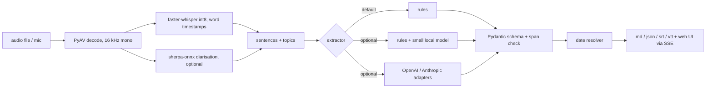

# VoiceScribe

**Meetings in, clean action items out.** VoiceScribe turns a meeting recording into a transcript with word-level
timestamps, splits it into sentences and topics, and pulls out decisions, owners and deadlines as structured,
validated action items. Everything runs offline on a CPU. Python, Whisper (faster-whisper), optional LLM adapters.

I built it to see how far a small, checkable pipeline gets before reaching for a big model, and to measure that
honestly instead of assuming it.


The web UI plays a recording. The waveform scrolls past a fixed playhead locked to `audio.currentTime`, each word
appears at its real Whisper timestamp, and every action item animates into the panel when the sentence it came from
ends. Tapping an item seeks the audio to its source. The `docs/` folder is a static copy that replays a recorded run,
so it can be hosted on GitHub Pages with no backend.

> The demo meeting is **synthetic speech** (voiced with Kokoro-82M, Apache-2.0, from a script I wrote with invented
> names and a made-up company). It is not a real meeting. The static page replays the saved output of a real run of this
> code on that audio, and says so in the UI.

## Quickstart

```bash
git clone https://github.com/Aditya2616/VoiceScribe && cd VoiceScribe
python -m venv .venv && source .venv/bin/activate      # Windows: .venv\Scripts\activate
pip install -e ".[dev]"
voicescribe fetch-models --whisper base.en              # one-time download (about 145 MB)
voicescribe serve                                       # http://127.0.0.1:8107
```

Transcribe your own file (any format PyAV can decode; no ffmpeg install needed):

```bash
voicescribe run meeting.wav --date 2026-11-12 --out outputs
```

Upload and microphone recording exist only in this local mode (50 MB and 30 minute caps; audio goes to a temp file
that is deleted after processing). The static demo only plays the bundled recording.

Optional extras: `pip install -e ".[diarize]"` plus `voicescribe fetch-models --diarize` (speaker labels),
`".[local]"` plus `voicescribe fetch-models --local` (the local model verifier), `".[synth]"` plus
`voicescribe fetch-models --synth` (regenerate the demo audio with `voicescribe synth-demo`).

## How it works



- **Decode and ASR.** PyAV decodes (so no ffmpeg), faster-whisper runs int8 with word timestamps. `av>=15,<17` is
  pinned because av 19 breaks faster-whisper 1.2.
- **Segmentation.** Sentences from punctuation with a pause fallback; topics with a TextTiling-style cohesion score.
- **Extraction.** An extractor ladder behind one interface (`VOICESCRIBE_EXTRACTOR`): rules; rules plus a small local
  model that only verifies and normalises the rule-found candidates (the owner is chosen from a closed list of names);
  and OpenAI/Anthropic adapters.
- **Validation.** Every item carries a source span that is checked against the transcript; items whose quote is not
  in the transcript are rejected. Deadlines such as "by next Friday" or "end of the month" are resolved to real
  dates relative to the meeting date.
- **Summary.** The offline summary is **extractive** (TF-IDF centrality, labelled "extractive" in the UI). Abstractive
  summaries only come from the hosted adapters.

## Results

All numbers come from runs on my CPU with the commands shown; raw output is in `results/`. The sets are small, so
treat differences of a few points as noise.

### Speech recognition (int8, CPU)

| Set | Model | Words | WER |
|---|---|---|---|
| LibriSpeech test-clean subset (12 utterances, read speech) | small.en | 278 | 3.96% |
| same | base.en | 278 | 6.12% |
| Synthetic demo meeting (Kokoro speech, scored against its script) | small.en | 336 | 1.49% (5 substitutions) |

Commands: `voicescribe eval wer --model small.en` and `voicescribe eval demo --model small.en`. Both are read or
synthetic speech, not real far-field meetings, so they say little about real meeting audio. Transcription ran at 0.84x
real time for small.en on the LibriSpeech clips while other jobs were using the CPU (`results/wer_small.en.json`).

**Word-timestamp accuracy** on the demo meeting (sentence first and last word against the TTS segment timings, 69
boundaries): median absolute error 100 ms, 90th percentile 255 ms, 87% within 250 ms. Sentence ends run about 170 ms
early on average, starts about 51 ms early. In the browser the revealed word count equals the number of words whose
start time is at or before `audio.currentTime` (checked by `scripts/screenshots.py`).

### Action-item extraction

Matching: a predicted item counts when it shares a sentence with a gold item of the same kind. There are 11
hand-labelled meetings that I wrote (about 15 sentences each): `dev` = 4, `test` = 4, `test2` = 3. The rules were
developed on `dev` and I looked at `test` while debugging, so both are optimistic. **`test2` (3 meetings, 9 gold
action items, 3 gold decisions) was written after the rules were frozen and is the only clean held-out number.**

| Extractor | Set (meetings) | Action P / R / F1 | Decision F1 |
|---|---|---|---|
| rules | dev (4) | 1.00 / 1.00 / 1.00 | 0.93 |
| rules | test (4) | 1.00 / 1.00 / 1.00 | 1.00 |
| rules | **test2 (3)** | 0.88 / 0.78 / 0.82 | 0.86 |
| rules + Qwen2.5-0.5B | dev (4) | 0.62 / 1.00 / 0.76 | 0.44 |
| rules + Qwen2.5-0.5B | test (4) | 0.80 / 1.00 / 0.89 | 0.57 |
| rules + Qwen2.5-0.5B | **test2 (3)** | 0.67 / 0.89 / 0.76 | 0.50 |
| rules + Qwen2.5-1.5B | dev (4) | 1.00 / 0.69 / 0.82 | 0.70 |
| rules + Qwen2.5-1.5B | test (4) | 1.00 / 0.75 / 0.86 | 0.77 |
| rules + Qwen2.5-1.5B | **test2 (3)** | 0.50 / 0.11 / 0.18 | 0.46 |

Command: `voicescribe eval extract --extractor rules --split test2`, and `--extractor local` with
`VOICESCRIBE_LOCAL_MODEL=Qwen/Qwen2.5-0.5B-Instruct` or `Qwen/Qwen2.5-1.5B-Instruct`.

**The rules alone win, so they are the default.** The 0.5B model finds the same items but adds false positives
(precision 10 to 40 points lower). The 1.5B model is more conservative and loses recall; on `test2` it kept almost
nothing. The local model stays as an optional extractor, not a recommended one. Owner accuracy is the weak spot of
every variant (0.56 to 0.71 on matched items): without speaker labels, "I'll do it" has no owner. On the demo
meeting the rules find 7 of 7 action items and 2 of 2 decisions with no false positives, but only 3 of 7 owners and
6 of 7 deadline dates are right (`results/demo_small.en.json`).

The hosted adapters (OpenAI, Anthropic) are written and unit-tested against stubbed HTTP transports only. I have
**not** run them against the live APIs, so there are no numbers for them.

### Speaker diarisation (optional, off by default)

sherpa-onnx (pyannote segmentation 3.0 plus WeSpeaker embeddings) on the 4-speaker synthetic meeting: **82% frame
accuracy** over speech frames, but it finds 3 speakers, not 4 (`python scripts/eval_diarize.py`, about 50 s; the
result is the same with the speaker count given). That is good enough to label the transcript, not to rely on.

## Tests and checks

```bash
ruff check src tests scripts
pytest                                   # 80 fast, offline tests
pytest -m slow                           # real Whisper / diarisation, needs downloaded models
python scripts/screenshots.py --serve    # headless Chromium at 1440x900 and 390x844: overflow, 44 px targets, console errors, reveal sync
python scripts/ui_flows.py               # demo click-to-seek, upload, and fake-device microphone recording
```

The UI was checked both served and as the static copy (`python scripts/build_docs.py`, then any file server on
`docs/`), with no console errors and no horizontal scroll at 390 px.

## Design decisions and limitations

- Rules first because they are inspectable and fast; a model is only worth its cost if it measurably helps. Here it did not.
- The local model only verifies candidates and picks owners from a closed list, because free generation at this size
  invented content in my early tests.
- The evaluation sets are small and written by me, in a style close to what the rules expect. Real meetings are
  messier (overlap, interruptions, indirect commitments), and I expect lower scores there.
- Whisper word times come from attention alignment and can stretch across pauses.
- Without diarisation, owners depend on names spoken in the sentence.
- English only (`.en` models). No live streaming transcription: recordings are processed after you stop.

## Credits and licences

Project: MIT, Aditya Jain. faster-whisper (MIT) and the Systran CTranslate2 Whisper weights (MIT); Kokoro-82M via
kokoro-onnx (Apache-2.0); sherpa-onnx (Apache-2.0) with pyannote segmentation 3.0 (MIT) and WeSpeaker ResNet34
VoxCeleb embeddings (CC-BY-4.0); Qwen2.5 (Apache-2.0); LibriSpeech test-clean (CC-BY-4.0, Panayotov et al. 2015).
Model weights are downloaded by script and not committed.

Built by [Aditya Jain](https://adityajain16.vercel.app). Research and design notes are in `docs/notes/`.
