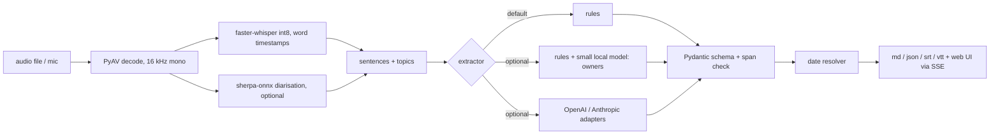

# VoiceScribe

**Meetings in, clean action items out.** VoiceScribe turns a meeting recording into a transcript with word-level
timestamps, splits it into sentences and topics, and pulls out decisions, owners and deadlines as structured,
validated action items. Everything runs offline on a CPU. Python, Whisper (faster-whisper), optional LLM adapters.

I built it to see how far a small, checkable pipeline gets before reaching for a big model, and to measure that
honestly instead of assuming it.


The web UI plays a recording. The waveform scrolls past a fixed playhead locked to `audio.currentTime`, each word
appears at its real Whisper timestamp, and every action item animates into the panel when the sentence it came from
ends. Tapping an item seeks the audio to its source. The `docs/` folder is a static copy that replays a recorded run,
so it can be hosted on GitHub Pages with no backend.

> The demo meeting is **synthetic speech** (voiced with Kokoro-82M, Apache-2.0, from a script I wrote with invented
> names and a made-up company). It is not a real meeting. The static page replays the saved output of a real run of this
> code on that audio, and says so in the UI.

## Quickstart

```bash
git clone https://github.com/Aditya2616/VoiceScribe && cd VoiceScribe
python -m venv .venv && source .venv/bin/activate      # Windows: .venv\Scripts\activate
pip install -e ".[dev]"
voicescribe fetch-models --whisper base.en              # one-time download (about 145 MB)
voicescribe serve                                       # http://127.0.0.1:8107
```

Transcribe your own file (any format PyAV can decode; no ffmpeg install needed):

```bash
voicescribe run meeting.wav --date 2026-11-12 --out outputs
```

Upload and microphone recording exist only in this local mode (with an optional participants field) (50 MB and 30 minute caps; audio goes to a temp file
that is deleted after processing). The static demo only plays the bundled recording.

Optional extras: `pip install -e ".[diarize]"` plus `voicescribe fetch-models --diarize` (speaker labels),
`".[local]"` plus `voicescribe fetch-models --local` (the local model verifier), `".[synth]"` plus
`voicescribe fetch-models --synth` (regenerate the demo audio with `voicescribe synth-demo`).

## How it works



- **Decode and ASR.** PyAV decodes (so no ffmpeg), faster-whisper runs int8 with word timestamps. `av>=15,<17` is
  pinned because av 19 breaks faster-whisper 1.2.
- **Segmentation.** Sentences from punctuation with a pause fallback; topics with a TextTiling-style cohesion score.
- **Extraction.** An extractor ladder behind one interface (`VOICESCRIBE_EXTRACTOR`): `rules` (default);
  `local`, rules plus a small model that picks an owner from a closed list of names for unassigned items;
  `local-verify`, rules plus a model that relabels candidates; and OpenAI/Anthropic adapters. Measured, only
  the rules are good enough to be the default (see Results).
- **Validation.** Every item carries a source span that is checked against the transcript; items whose quote is not
  in the transcript are rejected. Deadlines such as "by next Friday" or "end of the month" are resolved to real
  dates relative to the meeting date.
- **Summary.** The offline summary is **extractive** (TF-IDF centrality, labelled "extractive" in the UI). Abstractive
  summaries only come from the hosted adapters.

## Results

All numbers come from runs on my CPU with the commands shown; raw output is in `results/`. The sets are small, so
treat differences of a few points as noise.

### Speech recognition (int8, CPU)

| Set | Model | Words | WER |
|---|---|---|---|
| LibriSpeech test-clean subset (12 utterances, read speech) | small.en | 278 | 3.96% |
| same | base.en | 278 | 6.12% |
| Synthetic demo meeting (Kokoro speech, scored against its script) | small.en | 336 | 1.49% (5 substitutions) |

Commands: `voicescribe eval wer --model small.en` and `voicescribe eval demo --model small.en`. Both are read or
synthetic speech, not real far-field meetings, so they say little about real meeting audio.

**Speed.** I do not publish a transcription speed yet: the figures I have were taken while the CPU was busy with other
jobs, so they describe the load, not the model. `python scripts/rerecord_demo.py` measures tiny.en, base.en and small.en
on the CPU (int8, 3 threads), records the CPU busy fraction before each run, re-records the demo and only marks a figure
as clean when the CPU was under 25% busy. Its output goes to `results/speed_cpu.json`, and the demo banner shows the
number only when it is clean.

**Word-timestamp accuracy** on the demo meeting (sentence first and last word against the TTS segment timings, 69
boundaries): median absolute error 100 ms, 90th percentile 255 ms, 87% within 250 ms. Sentence ends run about 170 ms
early on average, starts about 51 ms early. In the browser the revealed word count equals the number of words whose
start time is at or before `audio.currentTime` (checked by `scripts/screenshots.py`).

### Action-item extraction

Matching: a predicted item counts when it shares a sentence with a gold item of the same kind. All meetings are
hand-labelled, written by me, invented names and companies, about 15 sentences each. `dev` has 4 meetings and is where
the rules were developed. **The held-out set is 9 meetings** (`test2`, 3 meetings, plus `held`, 6 meetings with 85
sentences, 23 action items and 6 decisions). The 6 `held` meetings were written after the rules were frozen, in
varied styles (terse stand-ups, chatty marketing calls, trailing and leading names, items with no owner), and I did
not tune on them. The 3 `test2` meetings I had already seen. One bug was fixed after the `held` run: the "Good, Rina."
reply rule was case-sensitive. A further 4 `test` meetings were looked at while debugging, so I do not use them as
evidence (they are in `results/` for completeness). Owner columns are correct / wrong / unassigned among matched items;
a wrong name counts against a method more than an unassigned item.

| Extractor | Set (meetings) | Action P / R / F1 | Decision F1 | Owners ok / wrong / none |
|---|---|---|---|---|
| rules (default) | dev (4) | 1.00 / 1.00 / 1.00 | 0.93 | 8 / 0 / 4 |
| rules (default) | **held-out** (9) | 0.93 / 0.84 / 0.89 | 0.89 | 17 / 0 / 9 |
| rules (default) | held (new 6 only) (6) | 0.95 / 0.87 / 0.91 | 0.91 | 13 / 0 / 7 |
| rules + 0.5B owner resolution | dev (4) | 1.00 / 1.00 / 1.00 | 0.93 | 8 / 0 / 4 |
| rules + 0.5B owner resolution | **held-out** (9) | 0.93 / 0.84 / 0.89 | 0.89 | 17 / 0 / 9 |
| rules + 0.5B owner resolution | held (new 6 only) (6) | 0.95 / 0.87 / 0.91 | 0.91 | 13 / 0 / 7 |
| rules + 1.5B owner resolution | dev (4) | 1.00 / 1.00 / 1.00 | 0.93 | 8 / 0 / 4 |
| rules + 1.5B owner resolution | **held-out** (9) | 0.93 / 0.84 / 0.89 | 0.89 | 17 / 2 / 7 |
| rules + 1.5B owner resolution | held (new 6 only) (6) | 0.95 / 0.87 / 0.91 | 0.91 | 13 / 1 / 6 |
| rules + 0.5B verifier | dev (4) | 0.65 / 1.00 / 0.79 | 0.40 | 8 / 0 / 4 |
| rules + 0.5B verifier | **held-out** (9) | 0.82 / 0.84 / 0.83 | 0.63 | 16 / 0 / 10 |
| rules + 0.5B verifier | held (new 6 only) (6) | 0.86 / 0.83 / 0.84 | 0.55 | 12 / 0 / 7 |
| rules + 1.5B verifier | dev (4) | 1.00 / 1.00 / 1.00 | 0.88 | 8 / 0 / 4 |
| rules + 1.5B verifier | **held-out** (9) | 0.90 / 0.81 / 0.85 | 0.70 | 16 / 0 / 9 |
| rules + 1.5B verifier | held (new 6 only) (6) | 0.90 / 0.83 / 0.86 | 0.67 | 13 / 0 / 6 |

Every row comes from `python scripts/run_extract_matrix.py` (raw files `results/extract_<method>_<split>.json`). Model
rows ran on the GPU in float16 with greedy scoring; the device and dtype are stored in each file, and the extractors
choose the device automatically and also run on a CPU in float32 (`--device cpu`).

**The rules alone are the default and are the best measured configuration.** On the 9 held-out meetings they find 0.93
precision / 0.84 recall for action items and 17 of 26 owners with no wrong name. The misses are vocabulary gaps ("renegotiate",
"survey" are not in the verb list; "would you mind ..."), and about a third of owners are unassigned because
a bare "I'll do X" does not say who is speaking when no diarisation is used.

*Owner resolution with a model.* The model sees the item, five sentences before and two after, and the closed list of
names, and may answer only a name or "unknown". The 0.5B model resolves nothing (it says unknown); the 1.5B model resolves
two items and gets both wrong, so it is worse than leaving owners unassigned. Looking at the probabilities, the 1.5B model
is confident and wrong on exactly the cases that cannot be resolved from text ("Nadia" for a sentence spoken by
Sol, because Nadia answered the line before): without speaker turns the transcript simply does not contain the
answer. The deterministic cues that do exist (an addressed request followed by an acceptance, a trailing name in a
request, "Thanks, Mei." after a commitment) are in the rules, which resolved the demo's "Lena" and "Rohan" items (6 of its 7 owners).

*The 1.5B "collapse" in the first version was a defect, not a finding.* My first verifier asked the model for a JSON label and
the 1.5B model answered "decision" for 11 of 13 candidates, including plain requests, and once with an invalid label
("discussion"); an owner "Almost" also came from a name-detection bug. I replaced free generation with closed-choice
scoring (each allowed answer is scored by its log-probability, so the model can only answer from the list) and fixed the
name detection. The repaired 1.5B verifier scores 0.90 / 0.81 / 0.85 on the held-out set against the rules' 0.93 / 0.84 / 0.89.
Its errors are action versus decision confusion: it calls commitments ("I can take that, I'll re-export it tomorrow",
"Sofia will own the runbook") decisions, and calls one decision an action. The 0.5B verifier adds false positives
(precision 0.82). Neither beats the rules, so neither is the default.

The hosted adapters (OpenAI, Anthropic) are written and unit-tested against stubbed HTTP transports only. I have
**not** run them against the live APIs, so there are no numbers for them. To use one, set `OPENAI_API_KEY` and
`OPENAI_MODEL`, or `ANTHROPIC_API_KEY` and `ANTHROPIC_MODEL`, and choose it with `VOICESCRIBE_EXTRACTOR`. There is no default
model id: the adapter raises a configuration error if the model variable is not set.

### Names

Recognition spells unusual names inconsistently ("Rohan" and "Rohen"), which in an earlier version of the demo
showed up as two different owners. Names the dialogue marks as names (an addressed request, "Thanks, X.", "X will ...")
are clustered by consonant skeleton and edit distance and rewritten to one spelling, in the transcript and in the owners.
With a participants list (`--participants "Ana, Ben"`, the API field `participants`, or the Participants field in
Upload/Record) that list is the closed set: names map to the nearest participant and an owner outside it becomes
unassigned. Without one, the most frequent spelling wins, which is not necessarily the right one: on the demo, recognition hears "Lena"
mostly as "Lina", so without a list it would show as Lina. The recorded demo run is made with the attendee list from the
script (Maya, Rohan, Lena, Theo), and the UI shows it as "participants given: ..." so it is clear the names were supplied, not inferred.
The labelled meetings contain no spelling variants, so the effect is covered by unit tests, not by a score.

### Speaker diarisation (optional, off by default)

sherpa-onnx (pyannote segmentation 3.0 plus WeSpeaker embeddings) on the 4-speaker synthetic meeting: **82% frame
accuracy** over speech frames, but it finds 3 speakers, not 4 (`python scripts/eval_diarize.py`, about 50 s; the
result is the same with the speaker count given). That is good enough to label the transcript, not to rely on.

## Tests and checks

```bash
ruff check src tests scripts
pytest                                   # 80 fast, offline tests
pytest -m slow                           # real Whisper / diarisation, needs downloaded models
python scripts/screenshots.py --serve    # headless Chromium at 1440x900 and 390x844: overflow, 44 px targets, console errors, reveal sync
python scripts/ui_flows.py               # demo click-to-seek, upload, and fake-device microphone recording
```

The UI was checked both served and as the static copy (`python scripts/build_docs.py`, then any file server on
`docs/`), with no console errors and no horizontal scroll at 390 px.

## Design decisions and limitations

- Rules first because they are inspectable and fast; a model is only worth its cost if it measurably helps. Here it did not.
- The local model only verifies candidates and picks owners from a closed list, because free generation at this size
  invented content in my early tests.
- The evaluation sets are small and written by me, in a style close to what the rules expect. Real meetings are
  messier (overlap, interruptions, indirect commitments), and I expect lower scores there.
- Whisper word times come from attention alignment and can stretch across pauses.
- Without diarisation, owners depend on names spoken in the sentence.
- English only (`.en` models). No live streaming transcription: recordings are processed after you stop.

## Credits and licences

Project: MIT, Aditya Jain. faster-whisper (MIT) and the Systran CTranslate2 Whisper weights (MIT); Kokoro-82M via
kokoro-onnx (Apache-2.0); sherpa-onnx (Apache-2.0) with pyannote segmentation 3.0 (MIT) and WeSpeaker ResNet34
VoxCeleb embeddings (CC-BY-4.0); Qwen2.5 (Apache-2.0); LibriSpeech test-clean (CC-BY-4.0, Panayotov et al. 2015).
Model weights are downloaded by script and not committed.

Built by [Aditya Jain](https://adityajain16.vercel.app). Research and design notes are in `docs/notes/`.
