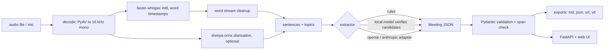

# VoiceScribe: spec

Meetings in, clean action items out. Python, Whisper, LLM APIs. Pipeline: transcribe, segment, summarise.
Local port 8107. Repo `Aditya2616/VoiceScribe`, MIT.

## 1. Architecture

Package `src/voicescribe/`:
- `audio.py` decode/resample/peaks (PyAV, numpy), waveform peak envelope for the UI.
- `asr.py` `Transcriber` protocol; `FasterWhisperTranscriber`, `StubTranscriber` (tests, replay); word cleanup.
- `segment.py` sentence splitter, pause fallback, TextTiling topics.
- `diarize.py` sherpa-onnx wrapper, speaker assignment to words by max overlap; model download script.
- `schema.py` Pydantic models (`Word`, `Sentence`, `Transcript`, `ActionItem`, `Decision`, `Meeting`) and span validators.
- `dates.py` relative deadline resolver against the meeting date.
- `extract/` `base.py` (interface, registry via `VOICESCRIBE_EXTRACTOR`), `rules.py`, `local.py` (transformers,
  verifier over candidates), `openai_adapter.py`, `anthropic_adapter.py` (httpx), `summary.py` (extractive).
- `export.py` Markdown minutes, JSON, SRT, VTT.
- `pipeline.py` orchestration, streaming events, progress callbacks.
- `cli.py` `voicescribe transcribe|extract|run|serve|eval|fetch-models|synth-demo`.
- `server.py` FastAPI.
- `eval/` `wer.py` (jiwer, normalisation), `extract_eval.py` (matching + P/R/F1), data under `data/`.

## 2. Service

- `GET /api/health`: versions, model availability, active extractor.
- `POST /api/transcribe` (multipart audio): returns a job id; `GET /api/jobs/{id}/events` is an SSE stream of
  `progress`, `sentence` (words with times), `action_item`, `decision`, `summary`, `done`. Real-time play-through in the
  UI is driven by audio time, not by server speed, so the events carry timestamps and the UI reveals them as the
  playhead passes.
- `GET /api/jobs/{id}`: final `Meeting` JSON. `GET /api/jobs/{id}/export?format=md|json|srt|vtt`.
- `GET /api/samples`, `POST /api/samples/{id}`: bundled demo meeting processed through the same path.
- Typed request/response models, upload size cap (50 MB), duration cap (30 min), temp files deleted, no audio retained.
- A single worker thread queue, since the CPU is the bottleneck.

## 3. Web UI

The full-size version of the portfolio's `voice` scene: audio streams past a playhead, the transcript writes itself
word by word, action items are extracted at the end of each sentence.

- **Waveform lane**: canvas, peak envelope from the real audio (server computes peaks, or `decodeAudioData` in the
  browser), scrolling past a fixed lime playhead in sync with `<audio>` currentTime (rAF reading `audio.currentTime`,
  not a timer). Zoom window of about 20 s. Speaker colour bands underneath when diarised.
- **Transcript**: each word from real timestamps fades/slides in as the playhead passes it; the current word is
  highlighted; sentence end triggers the extraction. Click a word or sentence to seek.
- **Structured panel**: summary, decisions, action items (task, owner chip, resolved deadline date with the original
  phrase, timestamp chip). Items animate in (transform/opacity, GSAP) when their source sentence ends during playback.
  Clicking an item seeks the audio to the source and flashes the source span in the transcript. Rule vs model
  provenance badge on each item.
- **Modes**: *Demo* (bundled synthetic meeting, replays real recorded output, works as static `docs/` with no backend),
  *Upload* (file picker and drag/drop), *Record* (MediaRecorder; after stopping, processed like an upload; live
  chunked transcription is not promised). Without a backend the Upload/Record controls explain that they need the
  local server.
- **Export** buttons: Markdown, JSON, SRT, VTT (generated client-side in demo mode, server-side otherwise).
- Design: tokens from the portfolio (`#07080a`, lime `#d7ff3f`, orange only for errors, Inter Tight / Instrument Serif
  italic / JetBrains Mono), 390 px first, 44 px targets, `prefers-reduced-motion` shows everything at once, canvas DPR
  capped at 2, drawing paused when off screen. Footer "Built by Aditya Jain" with both links. Light theme if cheap.
- Vanilla ES modules, GSAP from CDN, no build step.

## 4. Data

- `data/demo/meeting.wav` (+ `meeting.script.json` ground truth): about 3-4 minute, 4-speaker synthetic product-sync
  meeting voiced with Kokoro (script written by me). Reproducible via `voicescribe synth-demo`. Committed as 16 kHz
  mono Opus or compressed wav only if under about 3 MB, otherwise generated on demand and the recorded result JSON is
  what `docs/` ships (the audio for docs playback as an mp3/ogg if size allows, produced via PyAV).
- `data/eval/wer/`: about 12 LibriSpeech test-clean clips (CC-BY-4.0, attribution in `data/eval/wer/README.md`) plus
  reference text.
- `data/eval/extract/*.json`: about 8 hand-labelled meeting transcripts (sentences with ids; gold action items with
  owner, deadline phrase, resolved date and sentence ids; gold decisions).
- Models downloaded by `voicescribe fetch-models` into `models/` (git-ignored): Whisper via the HF cache, sherpa
  segmentation and embedding, Kokoro (dev/demo generation only), optional Qwen.

## 5. Evaluation (reproducible commands, numbers go into README only after real runs)

- `voicescribe eval wer --model base.en|small.en`: WER via jiwer with Whisper-style text normalisation, per clip and
  overall, plus decode real-time factor.
- `voicescribe eval extract --extractor rules|local`: precision, recall, F1 for action items (match = same owner
  and a sentence-span overlap, with separate scores for owner accuracy and deadline-date accuracy) and decisions.
  Matching rules and the label guideline documented. The rule extractor is developed on half the meetings and scored on
  a held-out half so the number is not tuned on the test set; the split is stated.
- Synthetic meeting end to end: WER of the ASR against the script, word-onset error of timestamps against the TTS
  segment timings, diarisation frame accuracy.
- Small hand-written set means wide uncertainty; the README says so.

## 6. Test plan (`pytest`, offline, fast by default; `-m slow` for model tests)

Fast: schema validation and span checks; date resolver table (many phrases and edge cases, month ends, weekdays);
sentence splitter; word-timestamp cleanup monotonicity; speaker assignment; rule extractor on fixtures; local
extractor JSON parsing and fallback with a fake generator; OpenAI/Anthropic adapters via `httpx.MockTransport`
(including error and malformed-JSON paths); exports (SRT/VTT timestamp formats, Markdown golden file); FastAPI routes
with the stub transcriber (health, upload, SSE order, size cap, bad file); eval metric functions on toy data.
Slow (marker): real tiny.en transcription of the JFK clip with word timestamps; sherpa diarisation on the demo; local
Qwen extraction smoke test.
CI: GitHub Actions with ruff and fast tests on Python 3.12 and 3.13.

## 7. Done means

1. Fresh clone, new venv, README quickstart works; model download script works offline-afterwards.
2. `pytest` and `ruff check` pass.
3. Demo meeting runs end to end through the real pipeline (real Whisper word timestamps, real extraction), and the
   recorded run is what the static `docs/` replays, labelled as recorded.
4. UI verified with Playwright screenshots at 1440x900 and 390x844 with no console errors; audio sync checked
   (playhead and word reveal stay within about 100 ms of `currentTime`); click-to-seek works; exports download.
5. Real numbers for WER, extraction P/R/F1, speed (real-time factor) in the README with the commands.
6. Clear README statement of which paths were exercised for real (Whisper, rules, local model, diarisation) and which
   are stub-tested adapters (OpenAI, Anthropic).
7. Clean git history, no weights or secrets, `git status` clean.

## 8. Risks

- `av` version drift breaks faster-whisper: pinned (`>=15,<17`) and covered by a slow test.
- A busy CPU and small-model quality: the local model only verifies rule candidates; honest numbers either way.
- Browser mic output is WebM/Opus: decoded by PyAV; tested with a generated WebM fixture.
- Whisper DTW word times can be loose: clamped, measured on the synthetic meeting.
- Kokoro voices can mispronounce names; choose simple names and check the Whisper transcript.
- Download budget (3 GB): Whisper small.en 485 MB + base.en 145 MB + Kokoro 120 MB + sherpa about 35 MB + Qwen 0.5B about 1 GB
  is about 1.8 GB. Qwen 1.5B (3 GB) is only an optional comparison.
