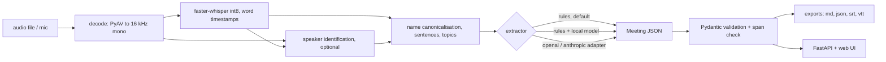

# VoiceScribe: design notes (as built)

Meetings in, clean action items out. Python, Whisper, optional LLM adapters. Pipeline: transcribe, segment, extract.
These notes describe the system as it is. The measured results are in the README and `results/`; the early
exploration that led here is in `RESEARCH.md`.

## 1. Architecture

Package `src/voicescribe/`:
- `audio.py` decode, resample, peak envelope for the waveform (PyAV, numpy), MP3 encoding for the demo.
- `asr.py` `Transcriber` protocol; `FasterWhisperTranscriber` (CPU, int8), `StubTranscriber` (tests).
- `segment.py` word clean-up, sentence splitter with pause fallback, TextTiling topics and topic labels.
- `names.py` one spelling per person (consonant skeleton plus edit distance), closed participants list.
- `diarize.py` speaker identification with sherpa-onnx: one embedding per recognised sentence, clustered by cosine distance
  (the method in use), plus the library's own segmentation pipeline kept as a measured baseline.
- `schema.py` Pydantic models (`Word`, `Sentence`, `Transcript`, `ActionItem`, `Decision`, `Meeting`) and span checks.
- `dates.py` relative deadline resolver against the meeting date.
- `extract/` `rules.py` (default), `local.py` (closed-choice owner resolution and verifier on a small local model),
  `openai_adapter.py` and `anthropic_adapter.py` (httpx, model id from the environment, tested with `MockTransport`),
  `summary.py` (extractive), `base.py` (registry, `VOICESCRIBE_EXTRACTOR`).
- `export.py` Markdown minutes, JSON, SRT, VTT. `pipeline.py` orchestration. `cli.py` and `server.py`.
- `eval/` WER, extraction scoring, speech-side scoring of the demo meeting.

## 2. Service

- `GET /api/health`: versions, Whisper size, extractor, diarisation availability, limits.
- `POST /api/jobs` (multipart: `file`, optional `date`, `title`, `diarize`, `extractor`, `participants`): returns a job.
- `GET /api/jobs/{id}`: status and, when done, the `Meeting` and waveform peaks.
- `GET /api/jobs/{id}/events`: server-sent progress events (decode, transcribe, speakers, extract).
- `GET /api/jobs/{id}/export?format=md|json|srt|vtt`.
- Upload cap 50 MB, duration cap 30 minutes, temporary file deleted after processing, no audio retained, one worker.

## 3. Web UI

The full-size version of the portfolio's voice scene: audio streams past a fixed lime playhead, the transcript writes
itself word by word from real timestamps, and action items animate in at the end of the sentence they came from.

- Waveform canvas driven by `audio.currentTime` (never a timer), about 20 s window, capped device pixel ratio.
- Transcript rows reveal word by word; a row's timestamp appears with its first word; tapping a word or row seeks.
- Structured panel: action items (owner, resolved deadline with the phrase it came from, timestamp, method), decisions,
  an extractive summary, exports (client-side in the static demo, server-side otherwise).
- Modes: Demo (the bundled synthetic meeting, a recorded run, works as the static `docs/` copy), Upload, Record
  (local server only). Upload and Record have a participants field.
- Phone: stage pinned at the top, player bar at the bottom, transcript sized to the space between them, 44 px targets,
  playback only from a tap, `prefers-reduced-motion` respected.
- Vanilla ES modules, no build step. `scripts/build_docs.py` copies `web/` to `docs/`.

## 4. Data

- `data/demo/`: the synthetic demo meeting (Kokoro-82M, script written by me, invented names), as MP3 with the script
  and the TTS segment timings. `docs/demo/meeting.json` is the recorded run the static page replays.
- `data/eval/wer/`: 12 LibriSpeech test-clean clips (CC-BY-4.0) with reference text.
- `data/eval/extract/`: hand-labelled meetings with gold action items and decisions, split into `dev`, `test`, `test2` and
  `held` (see the README for how each was used).
- `outputs/synth/` (git-ignored, regenerated by script): all labelled meetings voiced with Kokoro, with exact speaker turns.
- Models are downloaded by `voicescribe fetch-models` and are not committed.

## 5. Evaluation

Reproducible commands: `voicescribe eval wer|demo|extract`, `scripts/run_extract_matrix.py`, `scripts/eval_diarize.py`,
`scripts/rerecord_demo.py` (speed, demo re-recording), `scripts/synth_eval_meetings.py` (Kokoro audio for every labelled meeting),
`scripts/tune_diarize.py` (dev-only tuning), `scripts/eval_audio_owners.py` (diarisation quality and owners from audio). Matching rules for extraction are in `eval/extract_eval.py`.
`scripts/check_numbers.py` keeps every number in the README equal to its source file.

## 6. Tests

Fast and offline by default (`pytest`): schema and span checks, date resolver, sentence and topic segmentation, word
clean-up, name canonicalisation, rule extractor, the local extractor with a fake chooser, hosted adapters over
`httpx.MockTransport`, exports, FastAPI routes with the stub transcriber, metric functions, and the README number
check. Model tests are behind `-m slow`. CI (GitHub Actions) runs `ruff` and the fast tests on Python 3.11 and 3.13.

## 7. Known risks

- PyAV releases newer than the pinned range break faster-whisper 1.2.
- Whisper word times come from attention alignment and can stretch over pauses; they are clamped and measured.
- Speaker numbers come from synthetic voices and are an upper bound for real recordings.
- Small local models are over-confident about who owns an item when the text has no speaker turns; the rules are the
  default for that reason.
